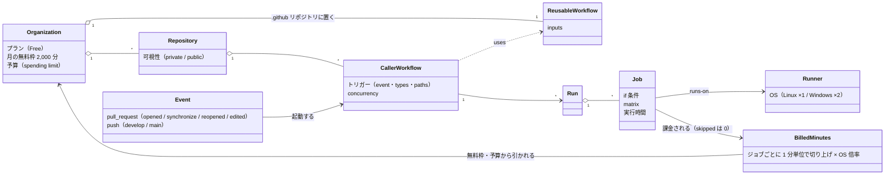

# CI 実行分数の削減（設計）

Organization 内のプライベートリポジトリで GitHub Actions の無料枠（Free プラン：月 2,000 分）を使い切ったため、CI の構成を見直す。
このページは設計成果物（オントロジー図・要件定義・テストシナリオ・設計・ロードマップ）の正本。

## 背景

- 2026-11 は 11/18 時点で Linux 1,725 分 + Windows 168 分（課金は 2 倍）＝ 約 2,061 分換算となり、無料枠を超えた。
- 課金はジョブごとに 1 分単位で切り上げられる。PR ごとに 1 分未満の短いジョブが 6〜9 本走るため、実行時間の合計より課金が大きく膨らむ。
  例として、C ビルドと Windows ビルドを持つリポジトリでは、今月の実行時間 373 分に対して課金は 906 分（約 2.4 倍）だった。
- 主な内訳
    - ブランチ名検査・自動ラベル・PR タイトル検査・コミット検査・Docs as Code 検査・docs ビルドが、それぞれ別のジョブ（各 1 分以上）になっている。
    - CI のトリガーに `edited` があり、PR のタイトルや本文を直しただけで全ジョブが再実行される（PR の CI 実行の約 3 割）。
    - develop へのマージ（push）でも、PR で通ったものと同じ CI がもう一度走る。
    - Windows と Python 3.10 のビルドが PR の push ごとに走る（Windows は課金 2 倍）。
    - 連続して push しても古い実行が止まらない。
- 共通ワークフローを Organization 外のリポジトリから参照している。本業の Organization なので、Organization の中で完結させる。

## オントロジー図



ジョブの数と OS が課金を決める。そのため、削減の手段は「ジョブを起動しない」「ジョブをまとめる」「Windows の回数を減らす」の 3 つになる。

## 要件定義

| ID | 要件 |
| :--- | :--- |
| R1 | 対象 8 リポジトリのワークフローが Organization 外のリポジトリを参照しない。共通ワークフローは `Advanced-Develop-2nd/.github` に置く。 |
| R2 | PR の検査内容（ブランチ名とマージ先、PR タイトル、コミットメッセージ、Docs as Code、自動ラベル、docs ビルド）は今と同じ判定を保つ。これらを 1 ジョブにまとめる。 |
| R3 | PR の本文だけを編集したときは、ジョブを 1 本も実行しない。タイトルかマージ先を変えたときは、検査ジョブだけを再実行する。ビルドは再実行しない。 |
| R4 | 同じ PR に新しい push が来たら、実行中の古い run を取り消す。本文の編集では取り消さない。 |
| R5 | Windows と Python 3.10 のビルドは、main 向けの PR と develop への push のときだけ実行する。 |
| R6 | docs と Markdown だけの変更では、ビルド系のジョブを起動しない（docs ビルドは検査ジョブの中で行う）。 |
| R7 | develop への push では検査ジョブと docs ビルドを実行しない。ビルドとテストだけを行う。 |
| R8 | main へのマージで release-drafter がリリースを作る動作を保つ。 |
| R9 | この `.github` リポジトリは公開されているので、エンドユーザー名や契約に関わる情報を書かない。 |
| R10 | 効果の目標：PR への push 1 回あたりの課金分を 50% 以上減らす。 |

ブランチ保護は Free プランのプライベートリポジトリでは使えない。そのため必須チェックの名前は登録されておらず、ジョブ名が変わってもマージは妨げられない。

## テストシナリオ

検証には C ビルドと Windows ビルドを持つリポジトリ（以下「C ビルド系」）を使う。T1 と T14 は全リポジトリが対象。

| ID | 手順 | 合格条件 |
| :--- | :--- | :--- |
| T1 | 8 リポジトリの `.github/workflows/` で、Organization 外のリポジトリを参照する `uses:` を検索する | 0 件 |
| T2 | `feature/*` → develop の PR を作る（src と docs を両方変更） | 「PR checks」1 ジョブとリポジトリ固有のビルドだけが走り、成功する。C ビルド系は Linux / Python 3.12 の 1 本だけ |
| T3 | 不正なブランチ名（prefix なし）で PR を作る | PR checks が失敗し、ログにブランチ名のエラーが出る |
| T4 | 規約に合わない PR タイトルで PR を作り、次にタイトルを直す | 作成時は PR checks が失敗する。タイトルを直すと PR checks だけが再実行されて成功し、ビルドの run は起動しない |
| T5 | PR の本文だけを編集する | 課金されるジョブが 0 本（run ができても全ジョブ skipped）。実行中の run は取り消されない |
| T6 | PR のマージ先を変える | PR checks が再実行され、マージ先の判定が新しい base で行われる |
| T7 | PR に続けて 2 回 push する | 1 回目の run が cancelled になる |
| T8 | docs だけを変えた PR を作る | ビルドの run が起動しない。PR checks は走り、docs ビルドが成功する |
| T9 | develop → main の PR を作る（C ビルド系） | ビルドが 3 本（Linux py3.12 / Linux py3.10 / Windows py3.12）走る。PR タイトル検査とコミット検査は実行されない |
| T10 | develop にマージする（push） | C ビルド系はビルド 3 本だけが走り、PR checks は走らない。ビルドを持たないリポジトリでは run が起動しない |
| T11 | src だけを変えた PR を作り、`skip-docs` ラベルを付けて再実行する | 最初は Docs as Code で失敗し、ラベルを付けて再実行すると成功する |
| T12 | PR を作る | ブランチ名に応じたラベルが今までどおり付く |
| T13 | main にマージする（リリース） | release-drafter がリリースを作る（G3 のときに確認） |
| T14 | 2026-12 第 1 週の課金レポートを集計する | PR への push 1 回あたりの課金分が 2026-11 と比べて 50% 以上減っている |

## 設計

### 新しい共通ワークフロー（このリポジトリ）

| ファイル | 内容 |
| :--- | :--- |
| `.github/workflows/reusable-pr-checks.yml` | PR の検査を 1 ジョブ「PR checks」にまとめる。ステップは、ブランチ名とマージ先 → PR タイトル → コミットメッセージ → Docs as Code → 自動ラベル → docs ビルド の順。前のステップが失敗しても後のステップを実行し（`!cancelled()`）、すべての失敗を 1 回の実行で見せる。入力は従来の `reusable-ci.yml` と `reusable-check-branch.yml` の入力を引き継ぐ。 |
| `.github/workflows/reusable-release-drafter.yml` | 従来と同じ内容を Organization 内に置く。設定ファイルが呼び出し側にない場合は、このリポジトリの `.github/release-drafter.yml` が使われる。 |

ジョブの起動条件（R3）は次のとおり。

```yaml
if: >-
  github.event.action != 'edited'
  || github.event.changes.base != null
  || github.event.changes.title != null
```

本文だけの編集のときも、ジョブは skipped として 1 件記録される。同じ名前だと、直前の「PR checks」の結果（失敗を含む）を上書きしてしまう。
そのため、本文だけの編集のときはジョブ名を「PR checks (skipped for body edit)」に切り替える。なお、skipped のジョブは名前の式を展開せずに表示されるので、PR の Checks には式の文字列が名前になった行が出る。

develop → main の PR では、PR タイトル検査とコミット検査をステップの `if` で飛ばす（従来と同じ）。

### 各リポジトリの変更

| ファイル | 変更 |
| :--- | :--- |
| `.github/workflows/pr-checks.yml`（新規） | `pull_request`（opened / synchronize / reopened / edited）で `reusable-pr-checks.yml@main` を呼ぶ。concurrency は PR 番号ごとに 1 グループとし、本文だけの編集は別グループにして既存の run を取り消さない（R4）。 |
| `check_branch.yml`、`pr-labeler.yml` | 削除する（PR checks に統合）。 |
| `ci.yml` | 共通ワークフローの呼び出しを外し、リポジトリ固有のビルドだけを残す。`edited` を外し、`paths-ignore`（`docs/**`、`**/*.md`、`mkdocs.yml`）と concurrency を足す。ビルドを持たないリポジトリでは `ci.yml` を削除する。 |
| `release-drafter.yml` | 参照先をこのリポジトリの `reusable-release-drafter.yml@main` に変える。 |
| `docs/development.md` など | ワークフロー名と検査の場所の記述を新しい構成に合わせる（Docs as Code）。 |

リポジトリの種類ごとに、PR への push 1 回で走るジョブは次のように変わる。

| 種類 | 今 | 変更後（develop 向け PR） |
| :--- | :--- | :--- |
| 検査だけ（3 件） | 6 本 | 1 本 |
| フロントエンドあり（1 件） | 7 本 | 2 本 |
| Simulink 系（3 件、MATLAB テストは self-hosted で課金なし） | 7 本 | 2 本 |
| C ビルド系（1 件） | 9 本（うち Windows 1 本 = 2 倍） | 2 本 |

C ビルド系では、ビルドの matrix を起動条件で切り替える。main 向けの PR と develop への push のときは 3 本、それ以外は Linux / Python 3.12 の 1 本にする（R5）。

### 見積もり（C ビルド系、2026-11 の実績にあてはめた場合）

| 区分 | 今の課金 | 変更後の見込み |
| :--- | ---: | ---: |
| PR（44 回 + 編集による再実行 18 回） | 約 640 分 | 約 100 分 |
| develop への push（41 回） | 約 250 分 | 約 250 分 |
| 合計 | 約 906 分 | 約 350 分（約 60% 減） |

### 適用の順序

呼び出し側は共通ワークフローを `@main` で参照する。そのため、このリポジトリの変更を先に main に入れてから、各リポジトリの PR をマージする。
検証（T2〜T12）は Actions が動く状態で行う必要がある。今月の無料枠を使い切っているため、検証の前に予算（spending limit）の設定が必要。

## TODO・ロードマップ

| 時期 | 作業 | 担当 |
| :--- | :--- | :--- |
| 11/18 | 設計（このページ）、G1 着手承認 | Claude → 本人 |
| 11/18 | Actions の予算を設定する（金額は本人が決める） | 本人 |
| 11/19 | このリポジトリに共通ワークフローを実装して PR、G2、main にマージ | Claude → 本人 |
| 11/19〜11/20 | C ビルド系で PR を作り、T1〜T12 を確認。G2 で develop にマージ | Claude → 本人 |
| 11/20〜11/25 | 残り 7 リポジトリに同じ変更を入れて PR、G2 | Claude → 本人 |
| 12/1〜12/7 | T14 の効果測定、報告 | Claude |
